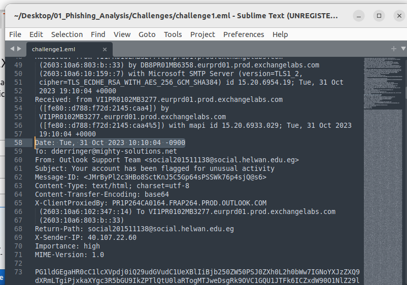
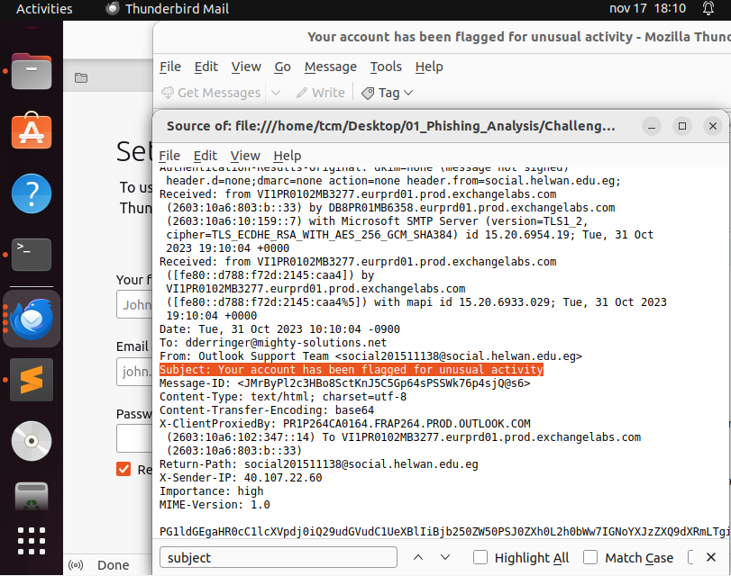
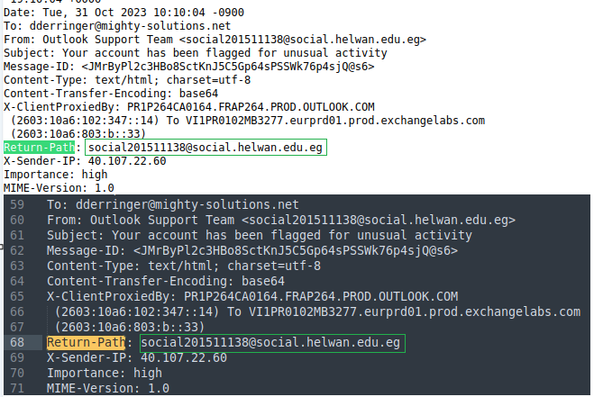
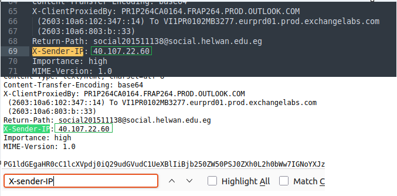

# Phishing Email Analysis – Investigation Evidence

## Investigation Overview

This section documents the evidence, analysis, and findings obtained during a hands-on phishing email investigation.

**Challenge File:** `01_Phishing_Analysis/Challenges/challenge1.eml`

**Tools Used:**
- Thunderbird
- Sublime Text
- Ubuntu Linux

---

## Investigation Questions & Findings

### 01. Email Header Analysis

#### Question 1 – Email Delivery Timestamp

**Question:**

Based on the contents of the email header, what is the full date and time of the email delivery?

**Evidence Source:** `challenge1.eml`

**Tools Used:** Thunderbird and Sublime Text.

**Evidence Identified:**

Date header:

`Tue, 31 Oct 2023 10:10:04 -0900`

Latest Received timestamp:

`Tue, 31 Oct 2023 19:10:10 +0000`

**Finding:**

The email's declared timestamp was Tuesday, October 31, 2023, at 10:10:04 (UTC-09:00).

The latest recorded receiving-server event occurred on Tuesday, October 31, 2023, at 19:10:10 (UTC).

**Analyst Observation:** 

#### Supporting Evidence

**Screenshot 1 – Email Header Analysis (Sublime Text)**

The Date header represents the timestamp declared in the original email, whereas the Received headers document the email's transmission through mail servers.

---

---

## Question 2 – Email Subject Identification

**Question:**

What is the subject of the email?

**Evidence Source:**
`01_Phishing_Analysis/Challenges/challenge1.eml`

**Finding:**

The subject of the email is:

`Your account has been flagged for unusual activity`

**Analysis:**
#### Supporting Evidence

**Screenshot 2 – Email Subject Identification (Sublime Text)**

The subject was identified by inspecting the `Subject` field in the original email header.

This subject uses language that suggests suspicious account activity, potentially creating a sense of urgency and encouraging the recipient to take action. This is a common social engineering technique used in phishing campaigns.

---

## Question 3 – Recipient Identification

**Question:**

Who was the email sent to?

**Evidence Source:**
`01_Phishing_Analysis/Challenges/challenge1.eml`

**Finding:**

The email was sent to:

`dderringer@mighty-solutions.net`

**Analysis:**
#### Supporting Evidence

**Screenshot 3 – Email Recipient Identification (Sublime Text)**

The recipient was identified by examining the `To` field in the original email header. This field specifies the email address listed as the intended recipient of the message.

---

## Question 4 – Sender Display Name Identification

**Question:**

Based on the sender's display name, who does the email claim to be from?

**Evidence Source:**
`01_Phishing_Analysis/Challenges/challenge1.eml`

**Finding:**

The email claims to be from:

`Outlook Support Team`

**Analysis:**
#### Supporting Evidence

**Screenshot 4 – Sender Display Name Identification (Sublime Text)**

The sender's display name was identified by examining the `From` field in the original email header.

Although the display name claims to represent the Outlook Support Team, this information alone does not verify the sender's identity or establish that the message was genuinely sent by Microsoft or Outlook.

---

## Question 5 – Sender Email Address Identification

**Question:**

What is the sender's email address?

**Evidence Source:**
`01_Phishing_Analysis/Challenges/challenge1.eml`

**Finding:**

The sender's email address is:

`social201511138@social.helwan.edu.eg`

**Analysis:**
#### Supporting Evidence

**Screenshot 5 – Sender Email Address Identification (Sublime Text-thunderbird)**

The sender's email address was identified by examining the `From` field in the original email header.

Although the display name claims to represent the Outlook Support Team, the actual sender address uses the domain `social.helwan.edu.eg`.

This discrepancy is a potential phishing indicator because the sender's email domain does not correspond to the organization represented by the display name.
---

## Question 6 – Bounce Email Address Identification

**Question:**

What email address is used for receiving bounced emails?

**Evidence Source:**
`01_Phishing_Analysis/Challenges/challenge1.eml`

**Finding:**

The bounce email address is:

`social201511138@social.helwan.edu.eg`

**Analysis:**
#### Supporting Evidence

**Screenshot 6 – Return-Path Header Identification (Sublime Text)**

The bounce email address was identified by examining the `Return-Path` field in the original email header.

This field indicates the address designated to receive email delivery failure notifications (bounce messages). In this case, the Return-Path address is the same as the sender's email address identified in Question 5.
---

## Question 7 – Sender Mail Server IP Identification

**Question:**

What is the IP address of the sender's email server?

**Evidence Source:**
`01_Phishing_Analysis/Challenges/challenge1.eml`

**Finding:**

The sender's email server IP address identified in the header is:

`40.107.22.60`

**Analysis:**
#### Supporting Evidence

**Screenshot 7 – Sender IP Address Identification (Sublime Text)**

The IP address was identified by examining the `X-Sender-IP` field in the original email header.

This field identifies the IP address associated with the sending server as reported by the email header. The address can be used as an indicator of compromise (IOC) for further investigation, including IP reputation checks and infrastructure analysis.

It is important to correlate this value with the `Received` headers before attributing the IP address to the original sender or attacker.
### Question 8 – Pending

### Question 9 – Pending

### Question 10 – Pending

### Question 11 – Pending

### Question 12 – Pending

### Question 13 – Pending

### Question 14 – Pending

### Question 15 – Pending

### Question 16 – Pending
