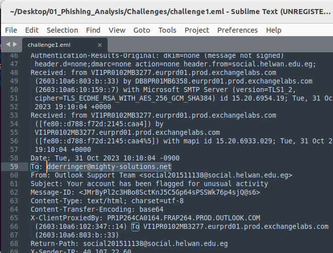

# Phishing Email Analysis – Investigation Evidence

## Investigation Overview

This section documents the evidence, analysis, and findings obtained during a hands-on phishing email investigation.

**Challenge File:** `01_Phishing_Analysis/Challenges/challenge1.eml`

**Tools Used:**
- Thunderbird
- Sublime Text
- Ubuntu Linux

---

## Investigation Questions & Findings

### 01. Email Header Analysis

#### Question 1 – Email Delivery Timestamp

**Question:**

Based on the contents of the email header, what is the full date and time of the email delivery?

**Evidence Source:** `challenge1.eml`

**Tools Used:** Thunderbird and Sublime Text.

**Evidence Identified:**

Date header:

`Tue, 31 Oct 2023 10:10:04 -0900`

Latest Received timestamp:

`Tue, 31 Oct 2023 19:10:10 +0000`

**Finding:**

The email's declared timestamp was Tuesday, October 31, 2023, at 10:10:04 (UTC-09:00).

The latest recorded receiving-server event occurred on Tuesday, October 31, 2023, at 19:10:10 (UTC).

**Analyst Observation:** 

#### Supporting Evidence

**Screenshot 1 – Email Header Analysis (Sublime Text)**

The Date header represents the timestamp declared in the original email, whereas the Received headers document the email's transmission through mail servers.

---

---

## Question 2 – Email Subject Identification

**Question:**

What is the subject of the email?

**Evidence Source:**
`01_Phishing_Analysis/Challenges/challenge1.eml`

**Finding:**

The subject of the email is:

`Your account has been flagged for unusual activity`

**Analysis:**
#### Supporting Evidence

**Screenshot 2 – Email Subject Identification (Sublime Text)**

The subject was identified by inspecting the `Subject` field in the original email header.

This subject uses language that suggests suspicious account activity, potentially creating a sense of urgency and encouraging the recipient to take action. This is a common social engineering technique used in phishing campaigns.

---

## Question 3 – Recipient Identification

**Question:**

Who was the email sent to?

**Evidence Source:**
`01_Phishing_Analysis/Challenges/challenge1.eml`

**Finding:**

The email was sent to:

`dderringer@mighty-solutions.net`

**Analysis:**
#### Supporting Evidence

**Screenshot 3 – Email Recipient Identification (Sublime Text)**

The recipient was identified by examining the `To` field in the original email header. This field specifies the email address listed as the intended recipient of the message.

### Question 4 – Pending

### Question 5 – Pending

### Question 6 – Pending

### Question 7 – Pending

### Question 8 – Pending

### Question 9 – Pending

### Question 10 – Pending

### Question 11 – Pending

### Question 12 – Pending

### Question 13 – Pending

### Question 14 – Pending

### Question 15 – Pending

### Question 16 – Pending
