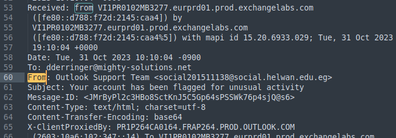
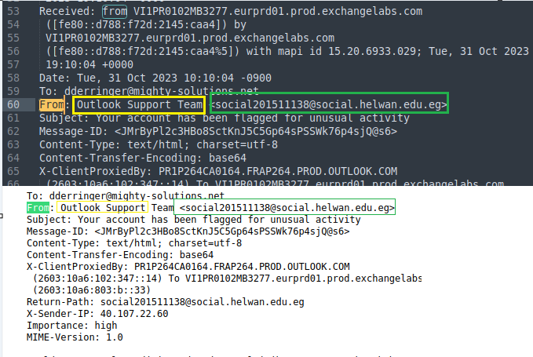
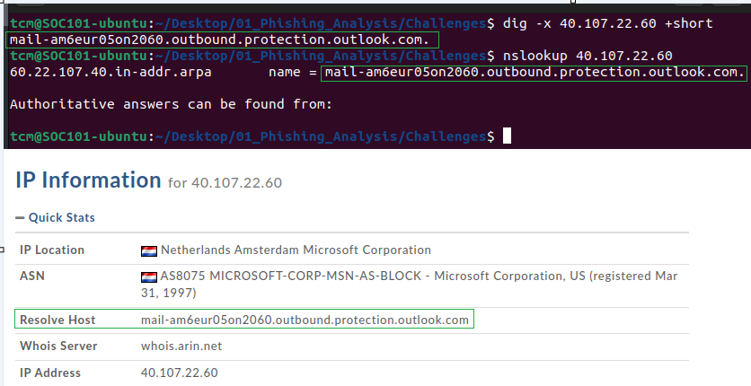
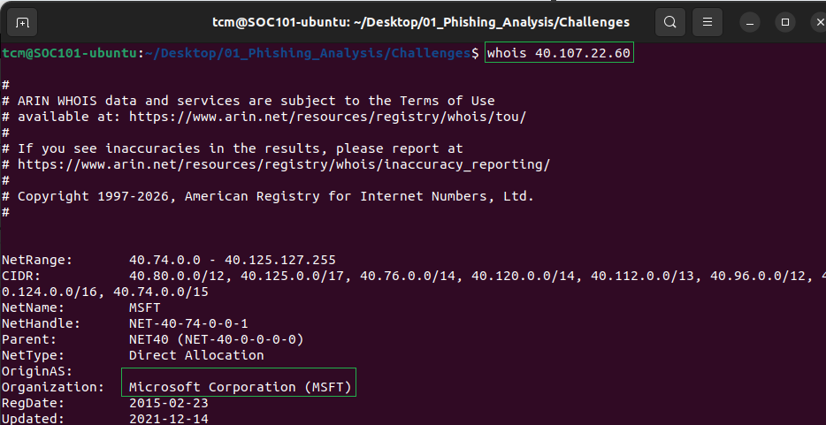
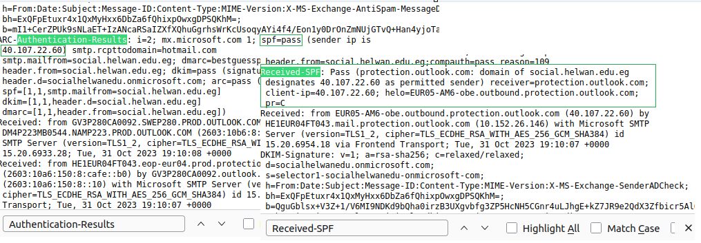
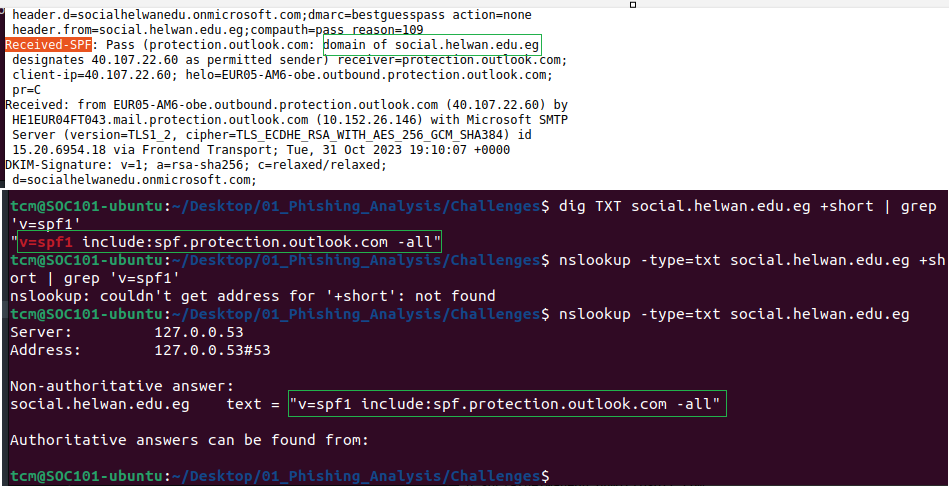

# Phishing Email Analysis – Investigation Evidence

## Investigation Overview

This section documents the evidence, analysis, and findings obtained during a hands-on phishing email investigation.

**Challenge File:** `01_Phishing_Analysis/Challenges/challenge1.eml`

**Tools Used:**
- Thunderbird
- Sublime Text
- Ubuntu Linux

---

## Investigation Questions & Findings

### 01. Email Header Analysis

#### Question 1 – Email Delivery Timestamp

**Question:**

Based on the contents of the email header, what is the full date and time of the email delivery?

**Evidence Source:** `challenge1.eml`

**Tools Used:** Thunderbird and Sublime Text.

**Evidence Identified:**

Date header:

`Tue, 31 Oct 2023 10:10:04 -0900`

Latest Received timestamp:

`Tue, 31 Oct 2023 19:10:10 +0000`

**Finding:**

The email's declared timestamp was Tuesday, October 31, 2023, at 10:10:04 (UTC-09:00).

The latest recorded receiving-server event occurred on Tuesday, October 31, 2023, at 19:10:10 (UTC).

**Analyst Observation:** 

#### Supporting Evidence

**Screenshot 1 – Email Header Analysis (Sublime Text)**


The Date header represents the timestamp declared in the original email, whereas the Received headers document the email's transmission through mail servers.

---

---

## Question 2 – Email Subject Identification

**Question:**

What is the subject of the email?

**Evidence Source:**
`01_Phishing_Analysis/Challenges/challenge1.eml`

**Finding:**

The subject of the email is:

`Your account has been flagged for unusual activity`

**Analysis:**
#### Supporting Evidence

**Screenshot 2 – Email Subject Identification (Sublime Text)**


The subject was identified by inspecting the `Subject` field in the original email header.

This subject uses language that suggests suspicious account activity, potentially creating a sense of urgency and encouraging the recipient to take action. This is a common social engineering technique used in phishing campaigns.

---

## Question 3 – Recipient Identification

**Question:**

Who was the email sent to?

**Evidence Source:**
`01_Phishing_Analysis/Challenges/challenge1.eml`

**Finding:**

The email was sent to:

`dderringer@mighty-solutions.net`

**Analysis:**
#### Supporting Evidence

**Screenshot 3 – Email Recipient Identification (Sublime Text)**


The recipient was identified by examining the `To` field in the original email header. This field specifies the email address listed as the intended recipient of the message.

---

## Question 4 – Sender Display Name Identification

**Question:**

Based on the sender's display name, who does the email claim to be from?

**Evidence Source:**
`01_Phishing_Analysis/Challenges/challenge1.eml`

**Finding:**

The email claims to be from:

`Outlook Support Team`

**Analysis:**
#### Supporting Evidence

**Screenshot 4 – Sender Display Name Identification (Sublime Text)**



The sender's display name was identified by examining the `From` field in the original email header.

Although the display name claims to represent the Outlook Support Team, this information alone does not verify the sender's identity or establish that the message was genuinely sent by Microsoft or Outlook.

---

## Question 5 – Sender Email Address Identification

**Question:**

What is the sender's email address?

**Evidence Source:**
`01_Phishing_Analysis/Challenges/challenge1.eml`

**Finding:**

The sender's email address is:

`social201511138@social.helwan.edu.eg`

**Analysis:**
#### Supporting Evidence

**Screenshot 5 – Sender Email Address Identification (Sublime Text-thunderbird)**



The sender's email address was identified by examining the `From` field in the original email header.

Although the display name claims to represent the Outlook Support Team, the actual sender address uses the domain `social.helwan.edu.eg`.

This discrepancy is a potential phishing indicator because the sender's email domain does not correspond to the organization represented by the display name.
---

## Question 6 – Bounce Email Address Identification

**Question:**

What email address is used for receiving bounced emails?

**Evidence Source:**
`01_Phishing_Analysis/Challenges/challenge1.eml`

**Finding:**

The bounce email address is:

`social201511138@social.helwan.edu.eg`

**Analysis:**
#### Supporting Evidence

**Screenshot 6 – Return-Path Header Identification (Sublime Text)**


The bounce email address was identified by examining the `Return-Path` field in the original email header.

This field indicates the address designated to receive email delivery failure notifications (bounce messages). In this case, the Return-Path address is the same as the sender's email address identified in Question 5.
---

## Question 7 – Sender Mail Server IP Identification

**Question:**

What is the IP address of the sender's email server?

**Evidence Source:**
`01_Phishing_Analysis/Challenges/challenge1.eml`

**Finding:**

The sender's email server IP address identified in the header is:

`40.107.22.60`

**Analysis:**
#### Supporting Evidence

**Screenshot 7 – Sender IP Address Identification (Sublime Text)**


The IP address was identified by examining the `X-Sender-IP` field in the original email header.

This field identifies the IP address associated with the sending server as reported by the email header. The address can be used as an indicator of compromise (IOC) for further investigation, including IP reputation checks and infrastructure analysis.

It is important to correlate this value with the `Received` headers before attributing the IP address to the original sender or attacker.
---

## Question 8 – Sender IP Resolved Hostname Identification

**Question:**

What is the resolved hostname of the sender's IP address?

**Evidence Source:**
`01_Phishing_Analysis/Challenges/challenge1.eml`

**Finding:**

The resolved hostname associated with sender IP address `40.107.22.60` is:

`mail-am6eur05on2060.outbound.protection.outlook.com`

**Analysis:**
#### Supporting Evidence

**Screenshot 8 – Reverse DNS Lookup (Ubuntu Terminal)**



The hostname was identified through reverse DNS (PTR) resolution of the sender IP address `40.107.22.60`.

Reverse DNS resolution maps an IP address to an associated hostname. This information helps analysts identify and investigate the mail infrastructure involved in email delivery.

The resolved hostname provides additional context for correlating the sender IP address with the infrastructure referenced in the email headers.
---

## Question 9 – Sender IP Address Ownership Identification

**Question:**

What corporation owns the sender's IP address?

**Evidence Source:**
`01_Phishing_Analysis/Challenges/challenge1.eml`

**Finding:**

The IP address `40.107.22.60` is registered to:

`Microsoft Corporation`

**Analysis:**
#### Supporting Evidence

**Screenshot 9 – WHOIS IP Ownership Lookup (Ubuntu Terminal)**



The IP address ownership was verified using the WHOIS lookup service provided by the American Registry for Internet Numbers (ARIN).

The WHOIS results identified the following information:

- **NetName:** MSFT
- **Organization:** Microsoft Corporation
- **NetType:** Direct Allocation
- **IP allocation range:** `40.74.0.0 - 40.125.127.255`

This confirms that the IP address belongs to an IP allocation registered to Microsoft Corporation.

From a cybersecurity investigation perspective, identifying the registered owner of an IP address helps analysts understand the infrastructure involved in email delivery.

However, IP ownership alone does not establish whether an email is legitimate or malicious. Additional analysis is required to determine the role of the IP address in the phishing campaign.
---

## Question 10 – SPF Authentication Result

**Question:**

What was the result of the SPF check?

**Evidence Source:**
`01_Phishing_Analysis/Challenges/challenge1.eml`

**Finding:**

The SPF authentication result was:

`PASS`

**Analysis:**
#### Supporting Evidence

**Screenshot 10 – SPF Authentication Result (Sublime Text)**



The SPF result was identified by examining the `Authentication-Results` and `Received-SPF` fields in the original email header.

The receiving mail server reported that the sender IP address `40.107.22.60` was authorized to send emails on behalf of the domain `social.helwan.edu.eg`.

The following header information supports this finding:

- **SPF result:** PASS
- **Sender IP:** `40.107.22.60`
- **Envelope sender domain:** `social.helwan.edu.eg`
- **Receiving mail system:** `protection.outlook.com`

An SPF PASS result indicates that the sending IP address passed the domain's SPF authorization check. However, SPF authentication alone does not establish that an email is legitimate or safe. Phishing emails can also pass SPF authentication.

---

## Question 11 – SPF Record Identification

**Question:**

What is the full SPF record of the sender's domain?

**Evidence Source:**
DNS TXT lookup for `social.helwan.edu.eg`

**Finding:**

The SPF record retrieved was:

`v=spf1 include:spf.protection.outlook.com -all`

**Analysis:**
#### Supporting Evidence
**Screenshot 11 – SPF Record Lookup (Ubuntu Terminal)**



The SPF record was retrieved using the `dig` command to query the DNS TXT records of the sender's domain.

The record contains three important components:

- **`v=spf1`:** Identifies the SPF version.
- **`include:spf.protection.outlook.com`:** Authorizes sending infrastructure permitted by Microsoft's SPF policy.
- **`-all`:** Specifies a hard-fail policy for senders that do not match the authorized mechanisms.

This record indicates that the domain delegates its SPF authorization to Microsoft's email protection infrastructure and explicitly rejects other unauthorized sending sources.

**Command Used:**

`dig TXT social.helwan.edu.eg +short | grep 'v=spf1'`

**Important Note:**

This lookup reflects the SPF record available at the time of investigation. It does not independently establish what the domain's SPF record contained on October 31, 2023.

---

## Question 13 – Email Body Transfer Encoding

**Question:**

What type of encoding was used to transfer the email body content?

**Evidence Source:**

Email headers from `01_Phishing_Analysis/Challenges/challenge1.eml`

**Finding:**

The email body uses **Base64 encoding**.

**Analysis:**

The email header contains the following declarations:

- `Content-Type: text/html; charset=utf-8`
- `Content-Transfer-Encoding: base64`

The `Content-Type` header identifies the body as HTML content using UTF-8 character encoding. The `Content-Transfer-Encoding` header specifies that Base64 was used to encode the body for email transmission.

Base64 is an encoding mechanism, not encryption. It does not provide confidentiality or protect the email content from unauthorized access.

**Command Used:**

```bash
grep -inE 'Content-Transfer-Encoding|Content-Type' challenge1.eml
```

### Question 13 – Pending

### Question 14 – Pending

### Question 15 – Pending

### Question 16 – Pending
