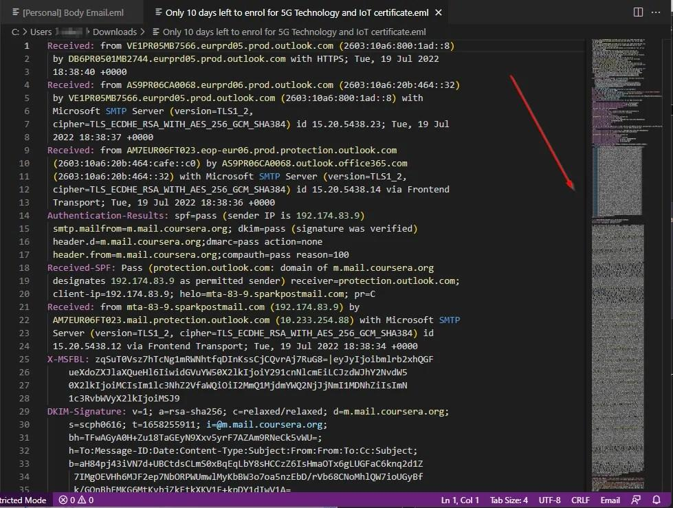

# Phishing Email Analysis – Investigation Evidence

## Investigation Overview

This section documents the evidence, analysis, and findings obtained during a hands-on phishing email investigation.

**Challenge File:** `01_Phishing_Analysis/Challenges/challenge1.eml`

**Tools Used:**
- Thunderbird
- Sublime Text
- Ubuntu Linux

---

## Investigation Questions & Findings

### 01. Email Header Analysis

#### Question 1 – Email Delivery Timestamp

**Question:**

Based on the contents of the email header, what is the full date and time of the email delivery?

**Evidence Source:** `challenge1.eml`

**Tools Used:** Thunderbird and Sublime Text.

**Evidence Identified:**

Date header:

`Tue, 31 Oct 2023 10:10:04 -0900`

Latest Received timestamp:

`Tue, 31 Oct 2023 19:10:10 +0000`

**Finding:**

The email's declared timestamp was Tuesday, October 31, 2023, at 10:10:04 (UTC-09:00).

The latest recorded receiving-server event occurred on Tuesday, October 31, 2023, at 19:10:10 (UTC).

**Analyst Observation:** 

#### Supporting Evidence

**Screenshot 1 – Email Header Analysis (Sublime Text)**

The Date header represents the timestamp declared in the original email, whereas the Received headers document the email's transmission through mail servers.

---

### Question 2 – Pending

### Question 3 – Pending

### Question 4 – Pending

### Question 5 – Pending

### Question 6 – Pending

### Question 7 – Pending

### Question 8 – Pending

### Question 9 – Pending

### Question 10 – Pending

### Question 11 – Pending

### Question 12 – Pending

### Question 13 – Pending

### Question 14 – Pending

### Question 15 – Pending

### Question 16 – Pending
